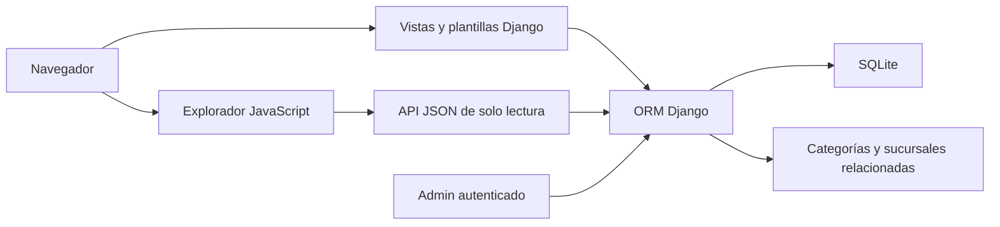

# Mis Reinas

Sitio público: https://bastiiiuuu.github.io/Misreinas/

Proyecto académico de una web comercial con Django: catálogo de ofertas, categorías, sucursales, filtros combinables, paginación y panel de administración. La versión del repositorio integra la base más avanzada del proyecto local y una API JSON de consulta.

No acredita una relación laboral con el comercio ni procesa compras o pagos. El formulario de contacto valida datos en el servidor y muestra una confirmación de demostración: no envía correos ni almacena consultas.

## Tecnologías

Python 3.13, Django 6.1.3, SQLite, ORM, plantillas Django, JavaScript y CSS. La API usa JsonResponse y consultas del ORM, sin incorporar otro framework.

## Iniciar desde cero

```powershell
git clone https://github.com/bastiiiuuu/Misreinas.git
cd Misreinas
python -m venv .venv
.\.venv\Scripts\python.exe -m pip install -r requirements-lock.txt
.\.venv\Scripts\python.exe manage.py migrate
.\.venv\Scripts\python.exe manage.py seed_demo
.\.venv\Scripts\python.exe manage.py runserver
```

Abre `http://127.0.0.1:8000/`. Los ejemplos creados por `seed_demo` llevan la marca DEMO, usan direcciones ficticias y no reemplazan los registros existentes. Las imágenes se generan localmente con Pillow. Ejecutar el comando otra vez no duplica los productos de demostración.

Para administrar el catálogo, ejecuta `python manage.py createsuperuser` usando el entorno virtual. El repositorio no distribuye usuarios, contraseñas ni una base de datos poblada.

## Probar la API

- `/api/`: índice de endpoints.
- `/api/ofertas/`: catálogo paginado, diez resultados por defecto.
- `/api/ofertas/1/`: una oferta por identificador.
- `/api/categorias/`: categorías públicas.
- `/api/sucursales/`: sucursales públicas.
- `/ofertas/explorar-api/`: interfaz que consume la API con fetch y presenta carga, errores, filtros y paginación.

Ejemplo: `/api/ofertas/?q=DEMO&categoria=demostracion&page_size=2&page=1`.

La API acepta GET y HEAD. Las escrituras permanecen en Django Admin, con autenticación y CSRF. `page_size` tiene un máximo de 100; una entrada mal formada devuelve 400 y un recurso inexistente devuelve 404 en JSON. Los precios son texto decimal en CLP o null cuando no hay precio.



## Comprobaciones

```powershell
.\.venv\Scripts\python.exe manage.py check
.\.venv\Scripts\python.exe manage.py makemigrations --check --dry-run
.\.venv\Scripts\python.exe manage.py test api --noinput
```

Las diez pruebas verifican las páginas existentes, filtros y paginación, límites de entrada, estados JSON, API de solo lectura, precio desconocido, consultas acotadas, escape HTML y validación/CSRF del contacto. Se ejecutan sobre una base de pruebas independiente.

## Configuración y datos

El modo local está activado por defecto y limitado a hosts de loopback. La clave local se genera en `.local-secret`, un archivo ignorado por Git. Para producción se requieren `DJANGO_DEBUG=0`, una `DJANGO_SECRET_KEY` aleatoria y privada de al menos 50 caracteres, y `DJANGO_ALLOWED_HOSTS` con los dominios autorizados. Sin clave de producción, el arranque falla en lugar de usar una clave pública.

La configuración productiva exige HTTPS y cookies seguras. Debe revisarse el alojamiento WSGI/ASGI, la terminación HTTPS y el servicio de static/media antes de publicar. No uses runserver como servidor productivo.

SQLite, media, sesiones, entornos virtuales y archivos de entorno no forman parte del código publicable. El historial antiguo puede conservar una base previamente versionada; retirar la copia vigente no borra ese historial. No reutilices credenciales históricas.

## Alojamiento y siguiente alcance

GitHub Pages y un alojamiento estático no ejecutan Django ni su base de datos. El portafolio puede enlazar el código, el diagrama y un recorrido del proyecto; una demostración completa requiere un servidor Python o ejecución local.

La API incorporada consulta el catálogo del propio proyecto. La integración con una API externa o con requisitos específicos de una evaluación queda pendiente de conocer esa pauta.

## Contexto y recursos

Las páginas conservan referencias comerciales y material del proyecto académico original. Los datos DEMO se distinguen de esas referencias. No se concede una licencia nueva sobre fotografías o marcas ajenas. La mejora técnica y documental se realizó con asistencia de IA.

Consulta [la guía del código](docs/guia-codigo.md) para estudiar el recorrido de una solicitud y preparar una demostración.


## Sitio público en GitHub Pages

La edición pública presenta Inicio, Nosotros, catálogo, sucursales y contacto. Conserva filtros combinables y paginación mediante páginas HTML generadas desde Django. No publica la API ni el Admin, y el contacto enlaza canales públicos en lugar de simular un envío. El backend original se conserva para ejecución Python.

```sh
python tools/export_public.py
python tools/check_public.py
```

El exportador crea una base en memoria con los campos públicos de `public_site/catalog.json`, renderiza las plantillas y copia únicamente imágenes y recursos referenciados. Los datos corresponden al catálogo del proyecto; no incluyen cuentas, sesiones ni credenciales. El workflow de Pages publica `public-build`. Para actualizar productos o imágenes se revisan los archivos de `public_site` y se vuelve a generar. El catálogo público no lleva registros ficticios de seed_demo. Confirma precios y disponibilidad con el local.
